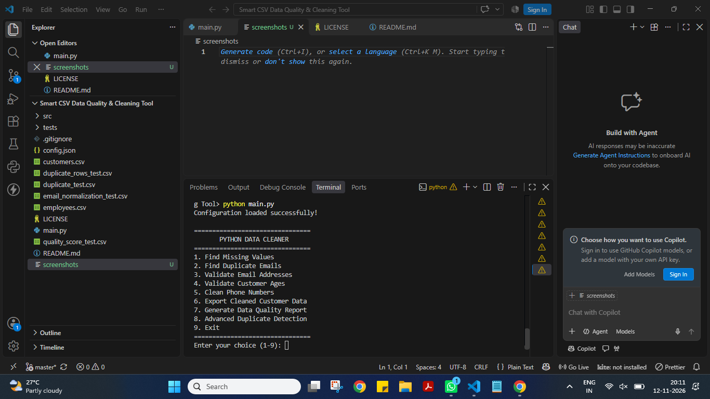
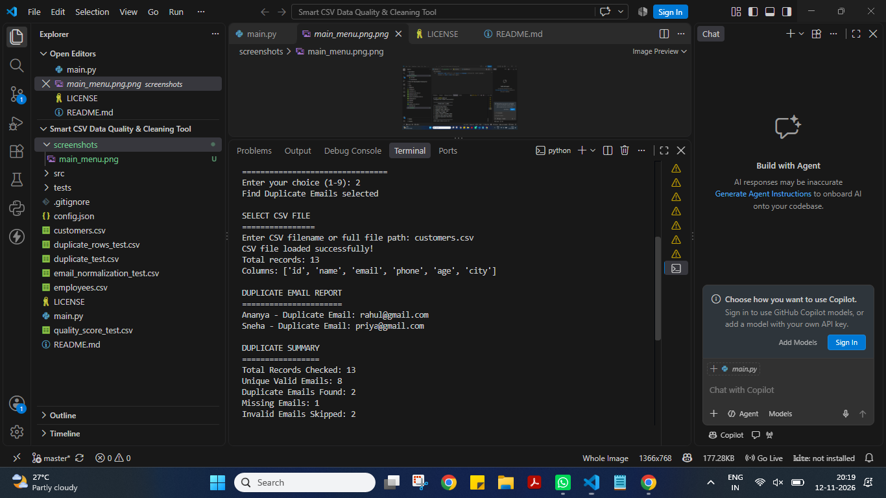
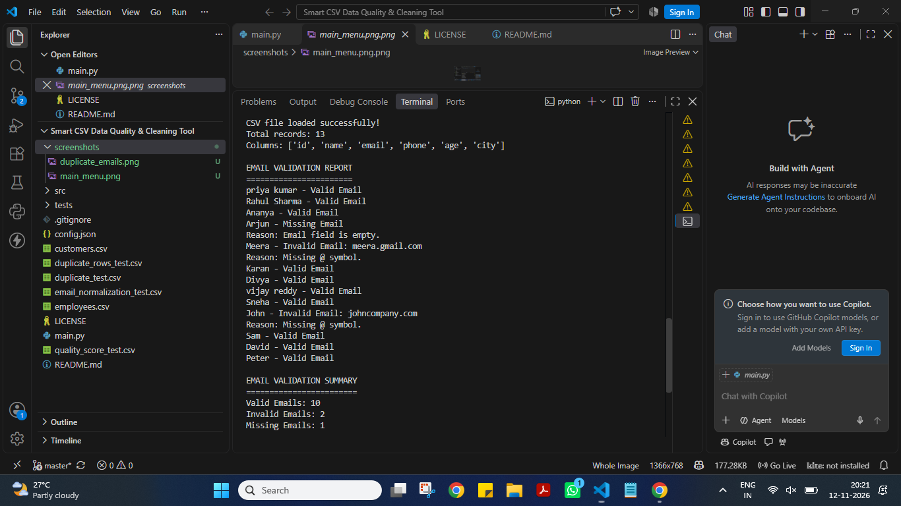
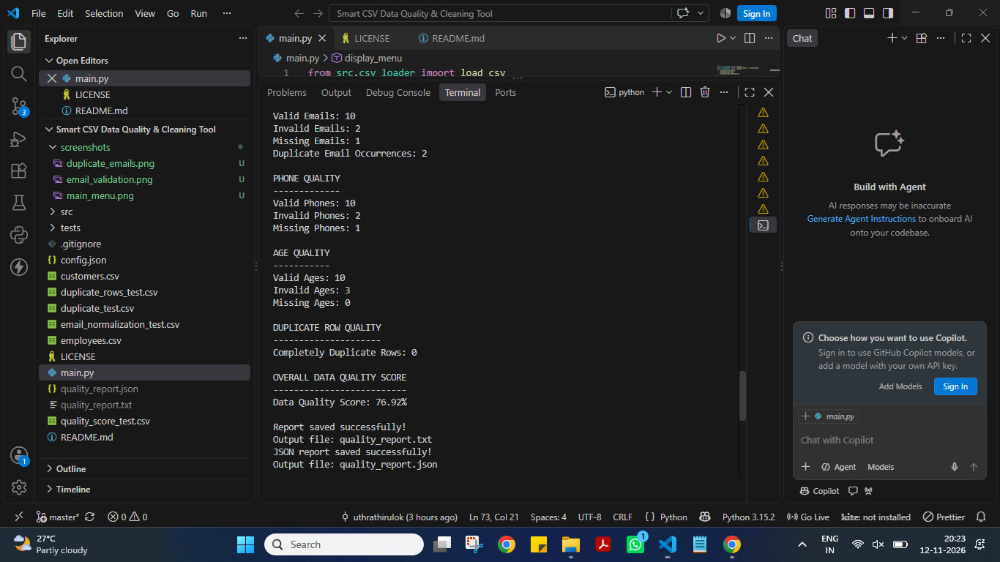

# Smart CSV Data Quality & Cleaning Tool

A Python-based tool that helps identify data quality issues, validate records, clean phone numbers, detect duplicate emails and records, and export cleaned CSV files.

## Features

- **CSV Loading:** Load different CSV files, such as `customers.csv` and `employees.csv`.
- **Missing Value Detection:** Identify missing email, phone, and age values.
- **Duplicate Email Detection:** Find duplicate email addresses, including case-insensitive duplicates.
- **Complete Duplicate Row Detection:** Identify records containing completely identical data.
- **Advanced Duplicate Detection:** Detect duplicate records using combinations of columns, such as name and phone.
- **Email Validation:** Identify valid, invalid, and missing email addresses.
- **Age Validation:** Validate ages using configurable minimum and maximum values.
- **Phone Cleaning:** Remove configured characters and country codes from phone numbers.
- **Data Quality Reports:** Generate reports showing valid, invalid, missing, and duplicate values.
- **CSV Export:** Export records with validation status and issue explanation columns.
- **Configurable Rules:** Customize validation and duplicate detection rules using `config.json`.
- **Configuration Error Handling:** Handle missing configuration files and invalid JSON safely.
- **Automated Testing:** Test project functionality using Python's built-in `unittest` module.
- **Streamlit Web Dashboard:** Interactive graphical interface for data cleaning and analysis.
- **Dashboard Navigation:** Separate pages for uploading CSV files, missing values, duplicate emails, email validation, age validation, phone cleaning, and data quality score.
- **CSV Preview:** Preview uploaded CSV data directly in the dashboard.
- **Download Reports:** Download generated data quality reports.

## Screenshots

### Main Menu



### Duplicate Email Detection



### Email Validation



### Data Quality Report



## Project Structure

```text
Smart CSV Data Quality & Cleaning Tool/
│
├── .gitignore
├── main.py
├── README.md
├── config.json
│
├── customers.csv
├── employees.csv
├── duplicate_test.csv
├── duplicate_rows_test.csv
├── email_normalization_test.csv
├── quality_score_test.csv
│
├── src/
│   ├── __init__.py
│   ├── csv_loader.py
│   ├── validators.py
│   ├── duplicate_checker.py
│   ├── reporter.py
│   ├── cleaner.py
│   ├── exporter.py
│   └── config_loader.py
│
└── tests/
    ├── __init__.py
    ├── test_validators.py
    ├── test_duplicate_checker.py
    ├── test_cleaner.py
    ├── test_csv_loader.py
    ├── test_exporter.py
    └── test_reporter.py
```

## Requirements

- Python 3.8 or later.
- Streamlit 1.50.0.

Install the required packages:

```bash
python -m pip install -r requirements.txt

## How to Run

1. Open the project folder in VS Code.
2. Open the terminal in the project folder.
3. Run:

```bash
python main.py
```

4. Select an option from the menu.
5. Enter the CSV filename when prompted.

```markdown
### Run the Streamlit Dashboard

Start the graphical dashboard using:

```bash
python -m streamlit run app.py

## Configuration

The project uses `config.json` to control validation and duplicate detection rules.

Example:

```json
{
    "email": {
        "require_at_symbol": true,
        "require_dot_in_domain": true
    },
    "age": {
        "minimum": 0,
        "maximum": 120
    },
    "phone": {
        "required_digits": 10,
        "country_code": "+91",
        "remove_characters": [" ", "-"]
    },
    "duplicates": {
        "check_email": true,
        "check_complete_rows": true,
        "combination_columns": ["name", "phone"]
    }
}
```

You can change these values to customize validation and duplicate detection rules.

The application also handles missing or incorrectly formatted configuration files.

## Output Files

The project generates:

- `cleaned_data.csv` – Exported records with validation statuses and issue explanations.
- `quality_report.txt` – Generated data quality report.
- `quality_report.json` – Generated data quality report in JSON format.

These generated files are excluded from Git using `.gitignore`.

## Running Automated Tests

Run all automated tests using:

```bash
python -m unittest discover -s tests -v
```

The project currently contains **18 automated tests** (verify this by running the command above).

The tests cover:

- Email validation
- Age validation
- Duplicate email detection
- Complete duplicate row detection
- Duplicate combination detection
- Phone cleaning
- CSV loading
- CSV export functionality
- Data quality reporting
- Missing values in duplicate combinations
- Empty dataset handling during export
- Email validation configuration

**Expected result:**

```text
Ran 18 tests

OK
```

## Learning Outcomes

This project demonstrates:

- Python functions and modules
- CSV file handling
- JSON configuration
- Data validation and cleaning
- Duplicate detection techniques
- Exception handling
- File handling
- Automated testing with `unittest`

## Future Improvements

- Generate PDF data quality reports.
- Add a graphical user interface.
- Support more configurable validation rules.
- Add more automated test cases.
- Support additional data file formats.
